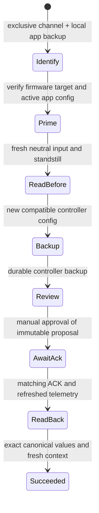

# Controller operations architecture

The native tool surface delegates asynchronous hardware jobs to
`McpDeviceOperations`. A concrete `VescMcpDevice` binds those jobs to the
existing GUI's `VescInterface`; tests substitute `FakeMcpDevice`, which never
opens a physical connection.

## Boundaries

- `McpServer`: bounded loopback HTTP/JSON-RPC, no hardware dependency.
- `VescMcpTools`: schemas, permission flags, app snapshot conflicts, parameter
  edits, local script files and tool results.
- `McpDeviceOperations`: one current controller job, backup files, polling,
  review requests, config upload/download, RT capture and LispBM chunks.
- `McpWriteTransaction`: config write states, independent of transport/device.
- `VescMcpDevice`: current device/firmware/CAN identity, real ConfigParams
  serialization, Commands requests and decoded reply signals.
- `Commands`: exclusive QObject-owned channel. Normal emitData callers and
  CAN route setters are blocked while the job holds it. The privileged API is
  C++ only, not Q_INVOKABLE. VescInterface's raw TCP/UDP forwarding is also
  blocked while exclusive access is held.
- `MainWindow`: progress/cancel and nonblocking, application-modal review.
  Only this trusted UI calls approval; no MCP tool can self-approve.

The device object is owned by the operation object. QObject-scoped callbacks,
QPointer lifetime checks and parented timers limit work to living app objects.
Controller jobs are cancelled/released when the native server is destroyed.
The most recent eight job results remain available for inspection.

## Configuration upload

The desired app configuration is captured before controller reads replace the
GUI model. Wire serialization is normalized through the same ConfigParams
codec before review. A serialization signature mismatch or invalid changed
value aborts. An unchanged configuration model is required at approval.
The review compares the immutable proposal with newly downloaded controller
values. Previously unsaved app values remain in the local app backup.

Fresh motor values and decoded active input are required. Numerical guard
defaults are NaN/unknown, not zero. A firmware flash pause may temporarily
withhold replies; ACK/config responses are buffered until fresh telemetry/input
can validate them, within the write transaction deadline. Unsafe fresh values,
lost connection/identity, a declined/stale review or failed backup prevent a
new write request. Exact readback is required for verified success.

The app guard supports No App, ADC and PPM input modes. It cannot prove neutral
input for combined/UART modes and refuses those uploads. CAN-id changes of a
forwarded device are also refused because they invalidate the existing route.

A write is sent once. Wrong ACK, readback mismatch, timeout or cancellation
after issuing it reports an unknown outcome, never successful rollback.
VESC wire ACKs do not carry transaction UUIDs: local exclusive ownership
prevents competing app traffic, but cannot exclude another physical CAN/UART
master or prove physical motor standstill.

## LispBM upload

The draft's SHA-256 is checked before its UTF-8 bytes are captured. The existing
controller payload is downloaded and saved before manual review. The firmware's
Lisp erase command stops the VM and erases its code/constant area. A separate
pause request is intentionally not used: it fails when no VM is running.

The image uses the existing firmware size/CRC/flags layout. Chunks are written
with matching offset ACKs, then the full payload is read back and compared.
The read API returns code after the eight-byte flash header; verification uses
that representation. There is no automatic write retry and no run request.
Source packing is restricted to self-contained scripts without host imports.

Partial/erased code is possible after a failed flash operation. The job retains
its backup reference and unknown-outcome status. Uploaded code can execute at
a later controller restart even though the upload does not auto-run it.

## Verification scope

Dedicated tests exercise the coordinator, fake controller jobs and actual
Commands ownership. Native app/client tests check the MCP surface, parameter
editing/restore, local script CRUD and permission failures. No physical
controller upload or LispBM execution has been tested. The guard logic is
conservative app-side protection, not a certified safety function.
